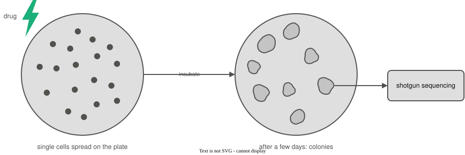

```{python}
#| echo: false
# Session 1's model, simulated reads, new read and likelihood function, rebuilt with the
# chapter's seeds so that this deck's numbers are the chapter's.
import numpy as np

rng = np.random.default_rng(61)
presence_prob = {"rRNA":     rng.uniform(0.15, 0.85, size=20),
                 "non-rRNA": rng.uniform(0.15, 0.85, size=20)}

def draw_labeled_read(share_rrna, presence_prob, rng):
    if rng.random() < share_rrna:
        label = "rRNA"
    else:
        label = "non-rRNA"
    present = rng.random(20) < presence_prob[label]
    return label, present

rng = np.random.default_rng(67)
label_list, reads = [], []
for _ in range(100000):
    label, present = draw_labeled_read(0.15, presence_prob, rng)
    label_list.append(label)
    reads.append(present)
labels = np.array(label_list)

rng = np.random.default_rng(126)
new_label, new_read = draw_labeled_read(0.15, presence_prob, rng)

def likelihood(present, probs):
    likelihood_p = 1.0
    for i in range(len(probs)):
        if present[i]:
            likelihood_p = likelihood_p * probs[i]
        else:
            likelihood_p = likelihood_p * (1 - probs[i])
    return likelihood_p

like_rrna = likelihood(new_read, presence_prob["rRNA"])
like_nonrrna = likelihood(new_read, presence_prob["non-rRNA"])
posterior_given = like_rrna * 0.15 / (like_rrna * 0.15 + like_nonrrna * 0.85)

# The method block's three-measurement example. Every number it shows is printed from here,
# so nothing on those slides is typed by hand.
m_p = [0.80, 0.30, 0.60]          # P(answer i is yes | class A)
m_q = [0.20, 0.70, 0.50]          # P(answer i is yes | class B)
m_share_a, m_share_b = 0.40, 0.60
m_answers = [True, False, True]   # the object we observed: yes, no, yes

def m_factors(probs):
    out = []
    for i in range(3):
        if m_answers[i]:
            out.append(probs[i])
        else:
            out.append(1 - probs[i])
    return out

m_fac_a, m_fac_b = m_factors(m_p), m_factors(m_q)
m_like_a = m_fac_a[0] * m_fac_a[1] * m_fac_a[2]
m_like_b = m_fac_b[0] * m_fac_b[1] * m_fac_b[2]
m_joint_a, m_joint_b = m_like_a * m_share_a, m_like_b * m_share_b
m_post_a = m_joint_a / (m_joint_a + m_joint_b)
m_post_b = m_joint_b / (m_joint_a + m_joint_b)

# Step 1: measurement 1 alone, for the one-measurement slide
m1_joint_a, m1_joint_b = m_share_a * m_p[0], m_share_b * m_q[0]
m1_total = m1_joint_a + m1_joint_b
m1_post_a, m1_post_b = m1_joint_a / m1_total, m1_joint_b / m1_total
m_total = m_joint_a + m_joint_b

# the 100-object table for the independence slide: class A, measurements 1 and 2
m_n = 100
m_cells = [[round(m_n * m_p[0] * m_p[1]), round(m_n * m_p[0] * (1 - m_p[1]))],
           [round(m_n * (1 - m_p[0]) * m_p[1]), round(m_n * (1 - m_p[0]) * (1 - m_p[1]))]]

# the cost slide: measurement 1 counted twice, with no new information
m_dbl_a = m_share_a * m_p[0] * m_p[0]
m_dbl_b = m_share_b * m_q[0] * m_q[0]
m_dbl_post_a = m_dbl_a / (m_dbl_a + m_dbl_b)

def f2(x):
    return f"{x:.2f}"

def f3(x):
    return f"{x:.3f}"

def f4(x):
    return f"{x:.4f}"

# Unit 4's 100,000 simulated reads at seed 41, for the counted likelihood, and its smooth GC curves
from math import comb
from scipy.stats import binom
from scipy.special import gammaln
import matplotlib.pyplot as plt

def draw_gc_from_two_groups(share_a, gc_a, gc_b, n_bases, rng):
    if rng.random() < share_a:
        return "A", rng.binomial(n_bases, gc_a)
    return "B", rng.binomial(n_bases, gc_b)

rng = np.random.default_rng(41)
species_list, gc_list = [], []
for _ in range(100000):
    s, g = draw_gc_from_two_groups(0.5, 0.66, 0.48, 40, rng)
    species_list.append(s)
    gc_list.append(g)
species = np.array(species_list)
gc = np.array(gc_list)
is_a = (species == "A")
n_a = is_a.sum()
count_a_25 = (gc[is_a] == 25).sum()

def smooth_binomial(k, n, p):
    log_choose = gammaln(n + 1) - gammaln(k + 1) - gammaln(n - k + 1)
    return np.exp(log_choose + k * np.log(p) + (n - k) * np.log(1 - p))

pmf_a_25 = binom.pmf(25, 40, 0.66)
pmf_b_25 = binom.pmf(25, 40, 0.48)
```

# Naive Bayes review

## Classifying which microbe a colony is

- Our collaborator streaked a mix of microbes on a plate, added a drug, and we picked one surviving colony to sequence
- A colony grows from one cell, so it is one microbe
- The colony is the **instance**, and its **class** is which microbe it is
- Its **features** are the GC counts of reads sequenced from it, one count per read
- Each read's **likelihood** comes from a microbe's GC content, and naive Bayes multiplies the reads' likelihoods
- The **posterior** of each microbe is its likelihood times its **prior**, divided by the **probability of the reads**

## Last time: two reads from one colony

```{python}
#| echo: false
# Unit 5 session 3's two reads and two microbes, with an even prior: one read, then both.
lt_reads = ["ATGCACCCTGTGGGCGAGCTGCCTATCGGCCGAAATACGC",
            "GTGCGGGCCACGCGGTGACCCATCTAGATGCGGGGTCTGC"]
lt_gc = {"A": 0.66, "B": 0.48}
lt_k = [sum(base in "GC" for base in read) for read in lt_reads]
lt_like = {m: [binom.pmf(k, 40, p) for k in lt_k] for m, p in lt_gc.items()}
lt_one = lt_like["A"][0] / (lt_like["A"][0] + lt_like["B"][0])
lt_two_a = lt_like["A"][0] * lt_like["A"][1]
lt_two_b = lt_like["B"][0] * lt_like["B"][1]
lt_two = lt_two_a / (lt_two_a + lt_two_b)
```

Two microbes could have grown into the colony, Microbe A with 66% GC and Microbe B with 48% GC, each with a prior of 1/2.

```{python}
#| echo: false
#| output: asis
print("```")
for i, read in enumerate(lt_reads):
    print(f">read{i + 1}  {read}  {lt_k[i]} of 40 G or C")
print("```")
```

. . .

- With read1 alone, the posterior of Microbe A was `{python} f"{lt_one:.2f}"`
- With both reads it rose to `{python} f"{lt_two:.3f}"`, because naive Bayes multiplied the two reads' likelihoods

. . .

Today, the colony could be any of three microbes, and we want each one's posterior.

## Naive Bayes Classification review

- Naive Bayes assumes all features are **conditionally independent** of each other
- Allows **joint probabilities** e.g. $P(x_1, x_2, \dots, x_n \mid y)$ to be factored into individual likelihoods $P(x_1 \mid y) \; P(x_2 \mid y) \cdots P(x_n \mid y)$
    - $x_1, \dots, x_n$ are an instance's $n$ features, and $y$ is its class
- This makes computing the posterior simple and efficient
- The assumption of conditional independence of all features usually does not hold
- But Naive Bayes classifiers often perform well

# Computing each microbe's posterior

## The experiment with three microbes

Our collaborator streaked a mix of three microbes on a plate, then added a drug that kills some of them.

{fig-align="center" width="90%"}

We sequenced one surviving colony. A colony grows from one cell, so every read from it comes from the same microbe.

## The colony could be any of three microbes

```{python}
#| echo: false
# The worked example PS6 builds on: session 2's three microbes (66%, 48% and 55% GC), session 3's
# two reads (25 and 28 G or C bases out of 40), naive Bayes over the reads, and posteriors
# normalized over all three microbes. Every number on these slides is computed here.
wx_gc = {"A": 0.66, "B": 0.48, "X": 0.55}
wx_k = [25, 28]
wx_n = 40
wx_even = {"A": 1 / 3, "B": 1 / 3, "X": 1 / 3}
wx_past = {"A": 0.05, "B": 0.05, "X": 0.90}
wx_like = {m: [binom.pmf(k, wx_n, p) for k in wx_k] for m, p in wx_gc.items()}

def wx_posterior(prior):
    """Each microbe's product of read likelihoods and prior, their total, and the posteriors."""
    product = {m: wx_like[m][0] * wx_like[m][1] * prior[m] for m in wx_gc}
    total = sum(product.values())
    return product, total, {m: product[m] / total for m in wx_gc}

wx_product, wx_total, wx_post = wx_posterior(wx_even)
wx_call = max(wx_post, key=wx_post.get)
wx_past_post = wx_posterior(wx_past)[2]
wx_past_call = max(wx_past_post, key=wx_past_post.get)
wx_read_fold = (wx_like["A"][0] * wx_like["A"][1]) / (wx_like["X"][0] * wx_like["X"][1])

def wx_sci(x):
    """Every product in one notation, so the three rows compare at a glance."""
    mantissa, exponent = f"{x:.3e}".split("e")
    return rf"{mantissa} \times 10^{{{int(exponent)}}}"
```

Our collaborator's plate held three microbes this time, and any of them could have grown into the colony we picked:

- Microbe A has 66% GC
- Microbe B has 48% GC
- Microbe X has 55% GC

. . .

We sequenced the same two reads as last time: read1 has 25 G or C bases out of 40, and read2 has 28.

Nothing favors one of them, so each starts with a prior of 1/3.

. . .

Which microbe is this colony, and how sure can we be?

## Naive Bayes splits the two reads' likelihood into one per read {.smaller}

For any microbe $m$, the chain rule splits the joint likelihood of the two reads, with no assumptions:

$$P(\text{read1, read2} \mid m) = P(\text{read1} \mid m) \times P(\text{read2} \mid \text{read1}, m)$$

. . .

Naive Bayes assumes the reads are **conditionally independent** given the microbe, so read1 tells us nothing more about read2:

$$P(\text{read2} \mid \text{read1}, m) = P(\text{read2} \mid m)$$

. . .

The joint likelihood is then a product of single-read likelihoods, one binomial per read:

$$P(\text{read1, read2} \mid m) = P(\text{read1} \mid m) \times P(\text{read2} \mid m)$$

## Bayes' theorem gives each microbe's posterior {.smaller}

The exact posterior probability is given as:

$$ \text{posterior} = \frac{\text{likelihood} \times \text{prior}}{\text{evidence}}$$

. . .

For our two reads and three microbes:

$$
\begin{aligned}
P(A \mid \text{read1, read2}) &= \frac{P(\text{read1} \mid A) \; P(\text{read2} \mid A) \; P(A)}{P(\text{read1, read2})} \\[4pt]
P(B \mid \text{read1, read2}) &= \frac{P(\text{read1} \mid B) \; P(\text{read2} \mid B) \; P(B)}{P(\text{read1, read2})} \\[4pt]
P(X \mid \text{read1, read2}) &= \frac{P(\text{read1} \mid X) \; P(\text{read2} \mid X) \; P(X)}{P(\text{read1, read2})}
\end{aligned}
$$

. . .

All three divide by the same evidence, $P(\text{read1, read2})$

## Each read's likelihood under each microbe

Each read's likelihood, such as $P(\text{read1} \mid A)$, is the binomial probability of its GC count $k$, with $n = 40$ bases and the microbe's GC content as $p$:

$$P(\text{read1} \mid A) = P(k = 25 \mid n = 40, p = 0.66)$$

. . .

```{python}
#| echo: false
#| output: asis
print(r"| microbe | GC content $p$ | $P(\text{read1} \mid \text{microbe})$, $k = 25$ | $P(\text{read2} \mid \text{microbe})$, $k = 28$ |")
print("|:---:|:---:|:---:|:---:|")
for m, p in wx_gc.items():
    print(f"| {m} | {p:.2f} | {wx_like[m][0]:.4f} | {wx_like[m][1]:.4f} |")
```

. . .

Both reads fit Microbe A best, but neither one rules out the others.

## Multiply each microbe's likelihoods by its prior {.smaller}

The reads are conditionally independent given the microbe, so naive Bayes multiplies them:

```{python}
#| echo: false
#| output: asis
lines = [rf"P(\text{{read1}} \mid {m}) \, P(\text{{read2}} \mid {m}) \, P({m}) &= "
         rf"{wx_like[m][0]:.4f} \times {wx_like[m][1]:.4f} \times \tfrac{{1}}{{3}} = {wx_sci(wx_product[m])}"
         for m in wx_gc]
print("$$\n\\begin{aligned}\n" + " \\\\\n".join(lines) + "\n\\end{aligned}\n$$")
```

. . .

```{python}
#| echo: false
#| output: asis
print(f"These three products are not probabilities yet: they add up to ${wx_sci(wx_total)}$, not to 1.")
```

. . .

We want to know which microbe is in the colony and *how sure are we, relative to the other microbes?*

. . .

## New notation: summation

$\sum$ adds up a list of items, the way $\prod$ multiplies them:

$$\sum_{i=1}^{n} a_i = a_1 + a_2 + \dots + a_n$$

. . .

- The index $i$ takes each value from 1 to $n$, and each value contributes one term
- For example, $\sum_{i=1}^{3} i = 1 + 2 + 3 = 6$

. . .

Can also take each value in a set $m \in \{ A, B, X \}$, gives the evidence:

$$P(\text{read1, read2}) = \sum_{m \in \{A, B, X\}} P(\text{read1} \mid m) \; P(\text{read2} \mid m) \; P(m)$$

## Dividing by their total gives the posteriors {.smaller}

The evidence is the total of the three products:

```{python}
#| echo: false
#| output: asis
print(rf"""$$\begin{{aligned}}
P(\text{{read1, read2}}) &= \sum_{{m \in \{{A, B, X\}}}} P(\text{{read1}} \mid m) \; P(\text{{read2}} \mid m) \; P(m) \\
&= {' + '.join(wx_sci(wx_product[m]) for m in wx_gc)} \\
&= {wx_sci(wx_total)}
\end{{aligned}}$$""")
```

. . .

Each microbe's posterior is its product divided by that total:

```{python}
#| echo: false
#| output: asis
lines = [rf"P({m} \mid \text{{read1, read2}}) &= \frac{{{wx_sci(wx_product[m])}}}{{{wx_sci(wx_total)}}} = {wx_post[m]:.3f}"
         for m in wx_gc]
print("$$\n\\begin{aligned}\n" + " \\\\[4pt]\n".join(lines) + "\n\\end{aligned}\n$$")
```

. . .

The three posteriors add up to 1, and the call is Microbe `{python} wx_call`, with a posterior of `{python} f"{wx_post[wx_call]:.2f}"`.

## The same steps in Python {.smaller}

```{python}
#| echo: true
from scipy.stats import binom

gc_content = {"A": 0.66, "B": 0.48, "X": 0.55}
prior = {"A": 1 / 3, "B": 1 / 3, "X": 1 / 3}
gc_counts = [25, 28]                 # G or C bases in read1 and read2, out of 40

products = {}
for microbe in gc_content:
    product = prior[microbe]
    for k in gc_counts:              # naive Bayes: multiply in each read's likelihood
        product = product * binom.pmf(k, 40, gc_content[microbe])
    products[microbe] = product

total = sum(products.values())       # the evidence
for microbe in products:
    print(f"{microbe}: {products[microbe] / total:.3f}")
```

## A strong prior can change the call

Suppose the drug was designed to kill Microbe A, and on past plates 90% of the surviving colonies were Microbe X.

. . .

```{python}
#| echo: false
#| output: asis
print("| microbe | even prior | posterior | prior from past plates | posterior |")
print("|:---:|:---:|:---:|:---:|:---:|")
for m in wx_gc:
    print(f"| {m} | {wx_even[m]:.2f} | {wx_post[m]:.3f} | {wx_past[m]:.2f} | {wx_past_post[m]:.3f} |")
```

. . .

The reads did not change, only the prior did, and the call moved from Microbe `{python} wx_call` to Microbe `{python} wx_past_call`.

The reads favor A over X by a factor of `{python} f"{wx_read_fold:.0f}"`, but the prior favors X over A by `{python} f"{wx_past['X'] / wx_past['A']:.0f}"`, so X wins.

## Naive Bayes in notation {.smaller}

For $K$ classes $C_1, \dots, C_K$ and $n$ features $x_1, \dots, x_n$, naive Bayes computes each class's posterior as:

$$
P(C_k \mid x_1, \dots, x_n) = \frac{P(C_k) \prod_{i=1}^{n} P(x_i \mid C_k)}{\sum_{j=1}^{K} P(C_j) \prod_{i=1}^{n} P(x_i \mid C_j)}
$$

. . .

- The numerator is one class's prior times its feature likelihoods
- The denominator is the evidence: the same numerator, added up over all $K$ classes
- The call is the class with the largest posterior: $C(x_1, \dots, x_n) = \arg\max_k P(C_k \mid x_1, \dots, x_n)$

. . .

In our example, $K = 3$ microbes, $n = 2$ reads, $x_i$ is read $i$'s GC count, and $P(x_i \mid C_k)$ is a binomial PMF.
