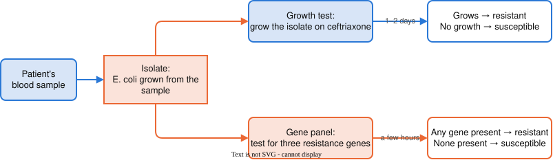
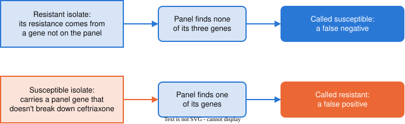

```{python}
#| echo: false
# About 15% of E. coli are resistant to ceftriaxone, in line with US surveillance: 15.3% of
# E. coli infections across VA hospitals in 2019 (Lancet Infect Dis 2024,
# doi:10.1016/S1473-3099(24)00416-X) and 12.9% of febrile UTIs at Kaiser Northern California
# (Ann Emerg Med 2021, doi:10.1016/j.annemergmed.2021.01.003).
#
# The panel's rule: any panel gene present -> call resistant. It misses resistance from a gene
# the panel doesn't test, and over-calls isolates carrying a panel gene that doesn't break down
# ceftriaxone.
import numpy as np

genes = ["blaCTX-M", "blaCMY-2", "blaSHV"]
share_resistant = 0.15

# P(gene present | class). Resistant isolates mostly carry CTX-M; a few carry none of the
# three. Susceptible isolates occasionally carry one.
gene_prob = {"resistant":   np.array([0.75, 0.12, 0.08]),
             "susceptible": np.array([0.02, 0.02, 0.03])}

def draw_isolate(rng):
    if rng.random() < share_resistant:
        growth = "resistant"
    else:
        growth = "susceptible"
    present = rng.random(3) < gene_prob[growth]
    return growth, present

def panel_call(present):
    if present.any():
        return "resistant"
    return "susceptible"

def draw_isolates(n, rng):
    rows = []
    for i in range(n):
        growth, present = draw_isolate(rng)
        rows.append({"isolate": f"EC-{i + 1:03d}", "present": present,
                     "call": panel_call(present), "growth": growth})
    return rows

def confusion(rows):
    c = {"TP": 0, "FP": 0, "FN": 0, "TN": 0}
    for r in rows:
        if r["call"] == "resistant" and r["growth"] == "resistant":
            c["TP"] += 1
        elif r["call"] == "resistant":
            c["FP"] += 1
        elif r["growth"] == "resistant":
            c["FN"] += 1
        else:
            c["TN"] += 1
    return c

def rates(c):
    n = c["TP"] + c["FP"] + c["FN"] + c["TN"]
    return {"n": n,
            "agree": c["TP"] + c["TN"],
            "accuracy":    (c["TP"] + c["TN"]) / n,
            "sensitivity": c["TP"] / (c["TP"] + c["FN"]),
            "specificity": c["TN"] / (c["TN"] + c["FP"]),
            "PPV":         c["TP"] / (c["TP"] + c["FP"])}

# The hand-countable table: 12 isolates. Seed 45 was chosen so that all four cells of the
# confusion table are filled: 2 caught, 1 missed (EC-011), 1 over-called (EC-012), 8 cleared.
small = draw_isolates(12, np.random.default_rng(45))
s = confusion(small)
sr = rates(s)
assert s == {"TP": 2, "FP": 1, "FN": 1, "TN": 8}
assert small[10]["call"] == "susceptible" and small[10]["growth"] == "resistant"
assert small[11]["call"] == "resistant" and small[11]["growth"] == "susceptible"

# A year of isolates: 500.
year = draw_isolates(500, np.random.default_rng(606))
y = confusion(year)
yr = rates(y)
y_res = y["TP"] + y["FN"]
y_sus = y["TN"] + y["FP"]
y_call_res = y["TP"] + y["FP"]

def f2(x):
    return f"{x:.2f}"

def pct(x):
    return f"{x:.0%}"
```

# A new problem

## A bloodstream infection

- A patient arrives at the hospital with a bloodstream infection caused by *E. coli*
- A common first choice of antibiotic is **ceftriaxone**
- Some *E. coli* are **resistant** to ceftriaxone: the drug doesn't stop them growing
    - About 15% of *E. coli* infections in US hospitals are resistant
- If the bacteria are resistant, the patient needs a different drug, and the sooner the better

. . .

The question for every patient: **is this patient's *E. coli* resistant to ceftriaxone?**

## Two ways to find out

{fig-align="center" width="100%"}

- An **isolate** is a population of bacteria grown from one patient's sample
- Both tests are run on the same isolate

## The growth test

- Spread the isolate on a plate that contains ceftriaxone, and wait
    - Colonies grow → the isolate is **resistant**
    - Nothing grows → the isolate is **susceptible**
- The growth test measures resistance directly: it asks whether the bacteria survive the drug
- It is the hospital lab's standard answer
- But it takes 1–2 days, and the patient is waiting

## The gene panel

- Bacteria resist ceftriaxone mostly by carrying genes for enzymes that break the drug down
- A **gene panel** tests an isolate for a short list of known resistance genes
- Our panel tests for three: *blaCTX-M*, *blaCMY-2* and *blaSHV*
- Results come back in a few hours

. . .

The panel's rule:

- If any of the three genes is present → call the isolate **resistant**
- If none is present → call the isolate **susceptible**

## The gene panel is a classifier

From last unit:

- **instance**: a single observation we wish to classify → one isolate
- **features**: characteristics used to tell instances apart → present or absent, for each of the three genes
- **labels**: the classes → resistant or susceptible
- **classifier**: a rule that assigns a label based on the features → *any gene present means resistant*

. . .

The panel never sees the drug. It **predicts** what the growth test will show.

## Can the panel replace the growth test?

- The panel is faster, but it is only useful if its predictions are right
- To find out how often it is right, run **both** tests on the same isolates and compare
- The growth test is our **reference**: the answer we treat as correct
    - Every measure of how well a classifier works compares its predictions to some reference

# Accuracy

## Twelve isolates {.smaller}

Twelve isolates from the hospital lab, run through the panel:

| Isolate | *blaCTX-M* | *blaCMY-2* | *blaSHV* | Panel call |
|---|:-:|:-:|:-:|---|
| EC-001 | – | – | – | susceptible |
| EC-002 | – | – | – | susceptible |
| EC-003 | – | – | – | susceptible |
| EC-004 | – | – | – | susceptible |
| EC-005 | – | – | – | susceptible |
| EC-006 | + | – | + | resistant |
| EC-007 | – | – | – | susceptible |
| EC-008 | + | – | – | resistant |
| EC-009 | – | – | – | susceptible |
| EC-010 | – | – | – | susceptible |
| EC-011 | – | – | – | susceptible |
| EC-012 | + | – | – | resistant |

: {.striped}

## Twelve isolates (cont.) {.smaller}

The same isolates, with the growth test's result beside the panel's call:

| Isolate | Panel call | Growth test |
|---|---|---|
| EC-001 | susceptible | susceptible |
| EC-002 | susceptible | susceptible |
| EC-003 | susceptible | susceptible |
| EC-004 | susceptible | susceptible |
| EC-005 | susceptible | susceptible |
| EC-006 | resistant | resistant |
| EC-007 | susceptible | susceptible |
| EC-008 | resistant | resistant |
| EC-009 | susceptible | susceptible |
| EC-010 | susceptible | susceptible |
| EC-011 | susceptible | resistant |
| EC-012 | resistant | susceptible |

: {.striped}

## Twelve isolates (cont.) {.smaller}

Does the panel's call agree with the growth test?

| Isolate | Panel call | Growth test | Agree? |
|---|---|---|:-:|
| EC-001 | susceptible | susceptible | ✓ |
| EC-002 | susceptible | susceptible | ✓ |
| EC-003 | susceptible | susceptible | ✓ |
| EC-004 | susceptible | susceptible | ✓ |
| EC-005 | susceptible | susceptible | ✓ |
| EC-006 | resistant | resistant | ✓ |
| EC-007 | susceptible | susceptible | ✓ |
| EC-008 | resistant | resistant | ✓ |
| EC-009 | susceptible | susceptible | ✓ |
| EC-010 | susceptible | susceptible | ✓ |
| **EC-011** | **susceptible** | **resistant** | **✗** |
| **EC-012** | **resistant** | **susceptible** | **✗** |

: {.striped}

## Accuracy

- **Accuracy** is the fraction of instances where the classifier's prediction agrees with the reference

. . .

- The panel agrees with the growth test on `{python} sr["agree"]` of `{python} sr["n"]` isolates:

```{python}
#| echo: false
#| output: asis
print(rf"$$\text{{accuracy}} = \frac{{{sr['agree']}}}{{{sr['n']}}} = {f2(sr['accuracy'])}$$")
```

. . .

- Accuracy is always measured against a reference
    - Here the reference is the growth test
    - A different reference would give a different accuracy

## Two kinds of mistakes

The panel got two isolates wrong, and the two mistakes are different:

- **EC-011**: the panel said *susceptible*, but the isolate grew on ceftriaxone
    - → a resistant isolate the panel **missed**
- **EC-012**: the panel said *resistant*, but the isolate did not grow
    - → a susceptible isolate the panel **over-called**

. . .

Accuracy counts both as "wrong" and doesn't say which kind happened.

## Where the panel's mistakes come from

{fig-align="center" width="100%"}

- A missed isolate: resistance can come from genes the panel doesn't test
- An over-called isolate: some versions of a panel gene don't break down ceftriaxone

## Positive and negative

- To name the kinds of mistakes, we first pick one class to call **positive**
    - Usually the class we are looking for
- Here: **resistant** is positive, **susceptible** is negative
- This is a choice, and every term on the next slides depends on it

## Four outcomes

Every isolate falls into exactly one of four outcomes:

| Outcome | Panel call | Growth test | In words |
|---|---|---|---|
| **true positive** (TP) | resistant | resistant | resistance caught |
| **false positive** (FP) | resistant | susceptible | over-called |
| **false negative** (FN) | susceptible | resistant | resistance missed |
| **true negative** (TN) | susceptible | susceptible | correctly cleared |

. . .

- *positive* or *negative* is what the **panel** said
- *true* or *false* is whether the panel **agreed with the growth test**

## The confusion table

A **confusion table** counts how many instances fall into each of the four outcomes:

|  | Growth test: resistant | Growth test: susceptible |
|---|:-:|:-:|
| **Panel: resistant** | TP | FP |
| **Panel: susceptible** | FN | TN |

- Rows are the classifier's predictions
- Columns are the reference

## The confusion table (cont.)

The twelve isolates:

|  | Growth test: resistant | Growth test: susceptible | Total |
|---|:-:|:-:|:-:|
| **Panel: resistant** | `{python} s["TP"]` (EC-006, EC-008) | `{python} s["FP"]` (EC-012) | `{python} s["TP"] + s["FP"]` |
| **Panel: susceptible** | `{python} s["FN"]` (EC-011) | `{python} s["TN"]` | `{python} s["FN"] + s["TN"]` |
| **Total** | `{python} s["TP"] + s["FN"]` | `{python} s["FP"] + s["TN"]` | `{python} sr["n"]` |

. . .

- Accuracy is the two agreeing cells, TP and TN, out of the total:

```{python}
#| echo: false
#| output: asis
print(rf"$$\text{{accuracy}} = \frac{{\text{{TP}} + \text{{TN}}}}{{\text{{total}}}} = \frac{{{s['TP']} + {s['TN']}}}{{{sr['n']}}} = {f2(sr['accuracy'])}$$")
```

## Accuracy answers one question

- Accuracy answers: *how often does the panel agree with the growth test?*
- A doctor or a lab might ask narrower questions:
    - Of the isolates that **are** resistant, how many does the panel catch?
    - Of the isolates that **are** susceptible, how many does the panel clear?
    - When the panel **says** resistant, how often is it right?
- Each question reads one part of the confusion table

## Sensitivity

**Sensitivity**: of the instances that are truly positive, the fraction the classifier calls positive

|  | **Growth test: resistant** | Growth test: susceptible |
|---|:-:|:-:|
| **Panel: resistant** | **`{python} s["TP"]`** | `{python} s["FP"]` |
| **Panel: susceptible** | **`{python} s["FN"]`** | `{python} s["TN"]` |

Read down the *resistant* column:

```{python}
#| echo: false
#| output: asis
print(rf"$$\text{{sensitivity}} = \frac{{\text{{TP}}}}{{\text{{TP}} + \text{{FN}}}} = \frac{{{s['TP']}}}{{{s['TP']} + {s['FN']}}} = {f2(sr['sensitivity'])}$$")
```

The panel caught `{python} s["TP"]` of the `{python} s["TP"] + s["FN"]` resistant isolates.

## Specificity

**Specificity**: of the instances that are truly negative, the fraction the classifier calls negative

|  | Growth test: resistant | **Growth test: susceptible** |
|---|:-:|:-:|
| **Panel: resistant** | `{python} s["TP"]` | **`{python} s["FP"]`** |
| **Panel: susceptible** | `{python} s["FN"]` | **`{python} s["TN"]`** |

Read down the *susceptible* column:

```{python}
#| echo: false
#| output: asis
print(rf"$$\text{{specificity}} = \frac{{\text{{TN}}}}{{\text{{TN}} + \text{{FP}}}} = \frac{{{s['TN']}}}{{{s['TN']} + {s['FP']}}} = {f2(sr['specificity'])}$$")
```

The panel cleared `{python} s["TN"]` of the `{python} s["TN"] + s["FP"]` susceptible isolates.

## Positive predictive value

**Positive predictive value** (PPV): of the instances the classifier calls positive, the fraction that are truly positive

|  | Growth test: resistant | Growth test: susceptible |
|---|:-:|:-:|
| **Panel: resistant** | **`{python} s["TP"]`** | **`{python} s["FP"]`** |
| **Panel: susceptible** | `{python} s["FN"]` | `{python} s["TN"]` |

Read across the *panel: resistant* row:

```{python}
#| echo: false
#| output: asis
print(rf"$$\text{{PPV}} = \frac{{\text{{TP}}}}{{\text{{TP}} + \text{{FP}}}} = \frac{{{s['TP']}}}{{{s['TP']} + {s['FP']}}} = {f2(sr['PPV'])}$$")
```

When the panel said *resistant*, it was right `{python} s["TP"]` times out of `{python} s["TP"] + s["FP"]`.

## Sensitivity and PPV are different questions

Both have TP on top, but they divide by different groups:

- **Sensitivity** divides by the isolates that **are** resistant (a column)
    - → starts from the growth test: *of the resistant isolates, how many did the panel catch?*
- **PPV** divides by the isolates the panel **called** resistant (a row)
    - → starts from the panel: *when the panel says resistant, how often is it right?*

. . .

A lab validating the panel asks about sensitivity. A doctor holding one panel result asks about PPV.

## Four numbers, four questions

| Measure | Question it answers | Part of the table | Twelve isolates |
|---|---|---|:-:|
| accuracy | How often does the panel agree with the growth test? | TP and TN, of all | `{python} f2(sr["accuracy"])` |
| sensitivity | Of the resistant isolates, how many are caught? | resistant column | `{python} f2(sr["sensitivity"])` |
| specificity | Of the susceptible isolates, how many are cleared? | susceptible column | `{python} f2(sr["specificity"])` |
| PPV | When the panel says resistant, how often is it right? | *panel: resistant* row | `{python} f2(sr["PPV"])` |

# A year of isolates

## The full year

Twelve isolates are enough to see where the numbers come from, but too few to judge the panel.

The hospital lab ran both tests on `{python} yr["n"]` isolates over a year:

|  | Growth test: resistant | Growth test: susceptible | Total |
|---|:-:|:-:|:-:|
| **Panel: resistant** | `{python} y["TP"]` | `{python} y["FP"]` | `{python} y_call_res` |
| **Panel: susceptible** | `{python} y["FN"]` | `{python} y["TN"]` | `{python} y["FN"] + y["TN"]` |
| **Total** | `{python} y_res` | `{python} y_sus` | `{python} yr["n"]` |

## The full year (cont.)

| Measure | Question it answers | Value |
|---|---|:-:|
| accuracy | How often does the panel agree with the growth test? | `{python} f2(yr["accuracy"])` |
| sensitivity | Of the resistant isolates, how many are caught? | `{python} f2(yr["sensitivity"])` |
| specificity | Of the susceptible isolates, how many are cleared? | `{python} f2(yr["specificity"])` |
| PPV | When the panel says resistant, how often is it right? | `{python} f2(yr["PPV"])` |

. . .

- The panel agrees with the growth test on `{python} pct(yr["accuracy"])` of isolates
- What else do the other three numbers tell us?

## What the accuracy contains

- `{python} pct(yr["accuracy"])` accuracy combines both kinds of mistake into one number
- The other measures separate them:
    - `{python} y["FN"]` of the `{python} y_res` resistant isolates were **missed** (sensitivity `{python} f2(yr["sensitivity"])`)
    - `{python} y["FP"]` of the `{python} y_call_res` *resistant* calls were **over-called** (PPV `{python} f2(yr["PPV"])`)

. . .

- Each missed isolate is a patient given ceftriaxone for an infection it won't treat
- Each over-called isolate is a patient moved off a drug that would have worked

## Next time

- Accuracy, sensitivity, specificity and PPV each answer a different question about the same predictions
- The panel makes two kinds of mistakes, and they have different consequences for the patient

Next time: which mistake is easier to live with, and how does that change which number we care about?
