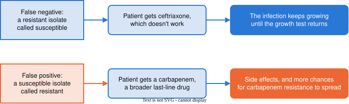

```{python}
#| echo: false
# About 15% of E. coli are resistant to ceftriaxone, in line with US surveillance: 15.3% of
# E. coli infections across VA hospitals in 2019 (Lancet Infect Dis 2024,
# doi:10.1016/S1473-3099(24)00416-X) and 12.9% of febrile UTIs at Kaiser Northern California
# (Ann Emerg Med 2021, doi:10.1016/j.annemergmed.2021.01.003).
#
# The panel's rule: any panel gene present -> call resistant. It gives a false negative when
# resistance comes from a gene the panel doesn't test, and a false positive when an isolate
# carries a panel gene that doesn't break down ceftriaxone.
import numpy as np

genes = ["blaCTX-M", "blaCMY-2", "blaSHV"]
share_resistant = 0.15

# P(gene present | class). Resistant isolates mostly carry CTX-M; a few carry none of the
# three. Susceptible isolates occasionally carry one.
gene_prob = {"resistant":   np.array([0.75, 0.12, 0.08]),
             "susceptible": np.array([0.02, 0.02, 0.03])}

def draw_isolate(rng):
    if rng.random() < share_resistant:
        growth = "resistant"
    else:
        growth = "susceptible"
    present = rng.random(3) < gene_prob[growth]
    return growth, present

def panel_call(present):
    if present.any():
        return "resistant"
    return "susceptible"

def draw_isolates(n, rng):
    rows = []
    for i in range(n):
        growth, present = draw_isolate(rng)
        rows.append({"isolate": f"EC-{i + 1:03d}", "present": present,
                     "call": panel_call(present), "growth": growth})
    return rows

def confusion(rows):
    c = {"TP": 0, "FP": 0, "FN": 0, "TN": 0}
    for r in rows:
        if r["call"] == "resistant" and r["growth"] == "resistant":
            c["TP"] += 1
        elif r["call"] == "resistant":
            c["FP"] += 1
        elif r["growth"] == "resistant":
            c["FN"] += 1
        else:
            c["TN"] += 1
    return c

def rates(c):
    n = c["TP"] + c["FP"] + c["FN"] + c["TN"]
    return {"n": n,
            "agree": c["TP"] + c["TN"],
            "accuracy":    (c["TP"] + c["TN"]) / n,
            "sensitivity": c["TP"] / (c["TP"] + c["FN"]),
            "specificity": c["TN"] / (c["TN"] + c["FP"]),
            "PPV":         c["TP"] / (c["TP"] + c["FP"])}

# The hand-countable table: 12 isolates. Seed 45 was chosen so that all four cells of the
# confusion table are filled: 2 TP, 1 FN (EC-011), 1 FP (EC-012), 8 TN.
small = draw_isolates(12, np.random.default_rng(45))
s = confusion(small)
sr = rates(s)
assert s == {"TP": 2, "FP": 1, "FN": 1, "TN": 8}
assert small[10]["call"] == "susceptible" and small[10]["growth"] == "resistant"
assert small[11]["call"] == "resistant" and small[11]["growth"] == "susceptible"

# A year of isolates: 500.
year = draw_isolates(500, np.random.default_rng(606))
y = confusion(year)
yr = rates(y)
y_res = y["TP"] + y["FN"]
y_sus = y["TN"] + y["FP"]
y_call_res = y["TP"] + y["FP"]

def f2(x):
    return f"{x:.2f}"

def pct(x):
    return f"{x:.0%}"

def big(n):
    return f"{n:,}"

# The conventions for reporting balance: prevalence is the diagnostic-accuracy term (STARD); the
# imbalance ratio is the imbalanced-learning literature's measure (KEEL groups datasets by it);
# the mild/moderate/extreme bands are the Google ML crash course's rule of thumb; the
# no-information rate is what R's caret prints beside every accuracy, and here it is the accuracy
# of the panel that never says resistant.
# A panel that calls every isolate susceptible, on the same year of isolates.
never = {"TP": 0, "FP": 0, "FN": y_res, "TN": y_sus}
never_acc = y_sus / yr["n"]
share_year = y_res / yr["n"]

# The same panel in three hospitals of 10,000 isolates each, catching and clearing isolates at
# our year's rates. 40% is in the range reported for bloodstream E. coli in some countries
# (cefotaxime 36.4%, Kor-GLASS 2017-2021, Ann Lab Med 2025, doi:10.3343/alm.2025.0145); 2% is a
# hospital where resistance is rare.
def hospital(share, n=10000):
    n_res = round(n * share)
    n_sus = n - n_res
    tp = round(n_res * yr["sensitivity"])
    fp = round(n_sus * (1 - yr["specificity"]))
    c = {"TP": tp, "FP": fp, "FN": n_res - tp, "TN": n_sus - fp}
    return c, rates(c)

hosp = {name: hospital(share) for name, share in (("rare", 0.02), ("ours", share_year), ("common", 0.40))}
```

# Where we left off

## The panel over a year

|  | Growth test: resistant | Growth test: susceptible | Total |
|---|:-:|:-:|:-:|
| **Panel: resistant** | `{python} y["TP"]` | `{python} y["FP"]` | `{python} y_call_res` |
| **Panel: susceptible** | `{python} y["FN"]` | `{python} y["TN"]` | `{python} y["FN"] + y["TN"]` |
| **Total** | `{python} y_res` | `{python} y_sus` | `{python} yr["n"]` |

. . .

```{python}
#| echo: false
#| output: asis
print(rf"""$$
\begin{{aligned}}
\text{{accuracy}} &= \frac{{\text{{TP}} + \text{{TN}}}}{{\text{{total}}}} = {f2(yr['accuracy'])}
&
\text{{sensitivity}} &= \frac{{\text{{TP}}}}{{\text{{TP}} + \text{{FN}}}} = {f2(yr['sensitivity'])} \\[0.6em]
\text{{specificity}} &= \frac{{\text{{TN}}}}{{\text{{TN}} + \text{{FP}}}} = {f2(yr['specificity'])}
&
\text{{PPV}} &= \frac{{\text{{TP}}}}{{\text{{TP}} + \text{{FP}}}} = {f2(yr['PPV'])}
\end{{aligned}}
$$""")
```

## The panel's two kinds of mistakes

|  | Growth test: resistant | Growth test: susceptible | Total |
|---|:-:|:-:|:-:|
| **Panel: resistant** | `{python} y["TP"]` | **`{python} y["FP"]`** | `{python} y_call_res` |
| **Panel: susceptible** | **`{python} y["FN"]`** | `{python} y["TN"]` | `{python} y["FN"] + y["TN"]` |
| **Total** | `{python} y_res` | `{python} y_sus` | `{python} yr["n"]` |


- **False negatives**: `{python} y["FN"]` resistant isolates the panel called susceptible
- **False positives**: `{python} y["FP"]` susceptible isolates the panel called resistant

. . .

Both count as "wrong" in the accuracy. Do they matter equally?

# Consequences of mistakes

## What happens after the panel's call

The panel's call decides the patient's first drug:

- Panel says **susceptible** → the patient gets **ceftriaxone**
- Panel says **resistant** → the patient gets a broader drug, such as a **carbapenem**

. . .

- The growth test still runs, and 1–2 days later it confirms or corrects the call
- So each mistake costs something during those 1–2 days

## A false negative: a resistant isolate called susceptible

- The panel says susceptible, so the patient gets ceftriaxone
- The bacteria are resistant, so ceftriaxone doesn't stop them
- The infection keeps growing until the growth test comes back
- In a bloodstream infection, each hour without a drug that works raises the risk of death

## A false positive: a susceptible isolate called resistant

- The panel says resistant, so the patient gets a carbapenem
- Ceftriaxone would have worked
- The patient gets a broader drug than needed:
    - side effects and cost
    - every use of a carbapenem gives bacteria a chance to become resistant to it
- Carbapenems are among the last drugs that work on resistant *E. coli*, so hospitals try to save them

## Which mistake is easier to live with?

Discuss with a neighbor:

- Who is harmed by each mistake, and when?
- Can the harm be undone when the growth test comes back?
- What is the worst thing that can happen after each one?

## Where the consequences come from

{fig-align="center" width="100%"}

- A false negative harms **this patient**, now
- A false positive mostly harms **later patients**, by spending a drug we want to keep working

## Which mistake is easier to live with? (cont.)

- There is no single right answer: it depends on how the panel's call is used
- For a patient with a bloodstream infection, a false negative is usually judged worse
    - → we want few false negatives
- But false positives are not free
    - → a panel that calls everything resistant would spend carbapenems on every patient
- Deciding which mistake matters more is a judgement about consequences, not a calculation

## Each measure tracks a different mistake

| Mistake | Measure that tracks it | Fewer of these mistakes means |
|---|---|---|
| false negative | sensitivity | higher sensitivity |
| false positive | specificity, PPV | higher specificity and PPV |
| both, mixed together | accuracy | higher accuracy |

. . .

If false negatives are what we fear most, sensitivity is the number to watch, not accuracy.

# Accuracy on imbalanced classes

## A panel that never says resistant

Imagine a "panel" that skips the genes and calls every isolate susceptible:

|  | Growth test: resistant | Growth test: susceptible | Total |
|---|:-:|:-:|:-:|
| **Panel: resistant** | `{python} never["TP"]` | `{python} never["FP"]` | `{python} never["TP"] + never["FP"]` |
| **Panel: susceptible** | `{python} never["FN"]` | `{python} never["TN"]` | `{python} never["FN"] + never["TN"]` |
| **Total** | `{python} y_res` | `{python} y_sus` | `{python} yr["n"]` |

## A panel that never says resistant (cont.)


|  | Growth test: resistant | Growth test: susceptible | Total |
|---|:-:|:-:|:-:|
| **Panel: resistant** | `{python} never["TP"]` | `{python} never["FP"]` | `{python} never["TP"] + never["FP"]` |
| **Panel: susceptible** | `{python} never["FN"]` | `{python} never["TN"]` | `{python} never["FN"] + never["TN"]` |
| **Total** | `{python} y_res` | `{python} y_sus` | `{python} yr["n"]` |

```{python}
#| echo: false
#| output: asis
print(rf"$$\text{{accuracy}} = \frac{{\text{{TP}} + \text{{TN}}}}{{\text{{total}}}} = \frac{{0 + {y_sus}}}{{{yr['n']}}} = {f2(never_acc)}$$")
```

. . .

- sensitivity = 0: every resistant isolate is a false negative
- specificity = 1: it gives no false positives
- PPV can't be computed: it never says resistant

. . .

All `{python} y_res` resistant isolates are false negatives, and its accuracy is still `{python} pct(never_acc)`.

## Comparing the two panels

| Measure | Gene panel | Never says resistant |
|---|:-:|:-:|
| accuracy | `{python} f2(yr["accuracy"])` | `{python} f2(never_acc)` |
| sensitivity | `{python} f2(yr["sensitivity"])` | 0.00 |
| specificity | `{python} f2(yr["specificity"])` | 1.00 |

- The accuracies differ by only `{python} round(100 * (yr["accuracy"] - never_acc))` points
- The sensitivities show the real difference: one panel catches resistance and the other doesn't

## New terminology: balance

- A dataset with roughly the same number of instances in each class is **balanced**
- A dataset where the classes have very different numbers of instances is **imbalanced**

. . .

- There is no hard rule for where balanced ends and imbalanced begins
- How balanced the classes are influences how we judge the results

. . .

Our isolates are imbalanced: `{python} pct(share_year)` resistant, `{python} pct(1 - share_year)` susceptible.

## Reporting class balance

- **Prevalence**: the share of the rarer class, `{python} y_res` of `{python} yr["n"]` = `{python} pct(share_year)`
- **Imbalance ratio**: larger class ÷ smaller class, `{python} y_sus` / `{python} y_res` = `{python} f"{y_sus / y_res:.2f}"`
- Rough bands for prevalence: mild 20–40%, moderate 1–20%, extreme under 1%

. . .

- **No-information rate**: the accuracy of always calling the larger class, `{python} f2(never_acc)` here
- Report accuracy next to it

## Accuracy is weighted by how common each class is

- `{python} y_sus` of the `{python} yr["n"]` isolates are susceptible, and only `{python} y_res` are resistant
- Accuracy mixes sensitivity and specificity, weighted by the share of each class:

```{python}
#| echo: false
#| output: asis
print(rf"""$$
\begin{{aligned}}
\text{{accuracy}} &= \text{{% resistant}} \times \text{{sensitivity}} + \text{{% susceptible}} \times \text{{specificity}} \\
&= {share_year:.2f} \times {yr['sensitivity']:.3f} + {1 - share_year:.2f} \times {yr['specificity']:.3f} = {f2(yr['accuracy'])}
\end{{aligned}}
$$""")
```

. . .

- When resistance is rare, accuracy mostly reports specificity
- A classifier can ignore the rare class and still score well

# The same panel in different hospitals

## Three hospitals

How common resistance is varies from place to place:

- a hospital where resistance is rare: **2%** of isolates resistant
- our hospital: **`{python} pct(share_year)`**
- a hospital where resistance is common: **40%**, as in some countries

. . .

Suppose the same panel catches and clears isolates at the same rates everywhere: sensitivity `{python} f2(yr["sensitivity"])` and specificity `{python} f2(yr["specificity"])`.

Each hospital runs both tests on 10,000 isolates.

## Three hospitals (cont.)

```{python}
#| echo: false
# One bar per hospital, 10,000 isolates long. Fill colour is the growth test's class, in the
# class label colours (.pos, .neg), so a false positive is blue: truly susceptible. Hatching
# marks the panel's mistakes. The cells are grouped by class, as in the confusion table's
# columns: resistant isolates (TP, FN) on the left, susceptible isolates (FP, TN) on the right.
import matplotlib
import matplotlib.pyplot as plt
plt.rcParams.update({"font.size": 14})

cells = [("TP", "#a30000", None,     "#ffffff"),
         ("FN", "#f2c4c4", "///",    "#a30000"),
         ("FP", "#c9daf0", "\\\\\\", "#1f5fa8"),
         ("TN", "#1f5fa8", None,     "#ffffff")]
rows = [("rare", "resistance rare (2%)"), ("ours", f"ours ({pct(share_year)})"),
        ("common", "resistance common (40%)")]
fig, ax = plt.subplots(figsize=(10, 4.6))
for y, (key, name) in enumerate(reversed(rows)):
    c = hosp[key][0]
    left = 0
    last_above = -10000
    for cell, fill, hatch, ink in cells:
        ax.barh(y, c[cell], left=left, height=0.55, color=fill, hatch=hatch,
                edgecolor=ink if hatch else "white", lw=0.8)
        mid = left + c[cell] / 2
        if c[cell] >= 600:
            box = dict(boxstyle="round,pad=0.15", fc=fill, ec="none") if hatch else None
            ax.text(mid, y, big(c[cell]), ha="center", va="center", color=ink, fontsize=13, bbox=box)
        else:
            # labels above the bar; a label too close to the one before it moves right on a leader
            x = max(mid, last_above + 700)
            ax.annotate(big(c[cell]), (mid, y + 0.28), xytext=(x, y + 0.36), ha="center", va="bottom",
                        color="#52514e", fontsize=11,
                        arrowprops=dict(arrowstyle="-", color="#52514e", lw=0.8) if x != mid else None)
            last_above = x
        left += c[cell]
ax.set_yticks(range(3), [name for _, name in reversed(rows)])
ax.set_xlim(0, 10000)
ax.set_xlabel("isolates")
ax.xaxis.set_major_formatter(matplotlib.ticker.FuncFormatter(lambda v, p: big(int(v))))
ax.spines[["top", "right", "left"]].set_visible(False)
ax.tick_params(axis="y", length=0)
handles = [matplotlib.patches.Patch(facecolor=f, hatch=h, edgecolor=i if h else f, label=l)
           for l, f, h, i in cells]
ax.legend(handles=handles, ncols=4, frameon=False, loc="lower center", bbox_to_anchor=(0.5, 1.0))
plt.tight_layout()
plt.show()
```

## Three hospitals (cont.)

| Hospital | Sensitivity | Specificity | PPV | Accuracy |
|---|:-:|:-:|:-:|:-:|
| resistance rare (2%) | `{python} f2(hosp["rare"][1]["sensitivity"])` | `{python} f2(hosp["rare"][1]["specificity"])` | **`{python} f2(hosp["rare"][1]["PPV"])`** | `{python} f2(hosp["rare"][1]["accuracy"])` |
| ours (`{python} pct(share_year)`) | `{python} f2(hosp["ours"][1]["sensitivity"])` | `{python} f2(hosp["ours"][1]["specificity"])` | **`{python} f2(hosp["ours"][1]["PPV"])`** | `{python} f2(hosp["ours"][1]["accuracy"])` |
| resistance common (40%) | `{python} f2(hosp["common"][1]["sensitivity"])` | `{python} f2(hosp["common"][1]["specificity"])` | **`{python} f2(hosp["common"][1]["PPV"])`** | `{python} f2(hosp["common"][1]["accuracy"])` |

. . .

- Sensitivity and specificity are the same in every hospital
- PPV ranges from `{python} f2(hosp["rare"][1]["PPV"])` to `{python} f2(hosp["common"][1]["PPV"])`, and accuracy changes too

## Why PPV changes

In the hospital where resistance is rare:

- There are only `{python} big(hosp["rare"][0]["TP"] + hosp["rare"][0]["FN"])` resistant isolates to catch, and the panel catches `{python} big(hosp["rare"][0]["TP"])`
- There are `{python} big(hosp["rare"][0]["FP"] + hosp["rare"][0]["TN"])` susceptible isolates, and `{python} big(hosp["rare"][0]["FP"])` of them are false positives

. . .

- So most of its *resistant* calls are wrong: PPV = `{python} big(hosp["rare"][0]["TP"])` / (`{python} big(hosp["rare"][0]["TP"])` + `{python} big(hosp["rare"][0]["FP"])`) = `{python} f2(hosp["rare"][1]["PPV"])`
- The number of false positives grows with the number of susceptible isolates, however good the panel is

## What travels with the panel

- **Sensitivity** and **specificity** describe the panel
    - each is measured within one class, so it doesn't depend on how common that class is
- **PPV** and **accuracy** describe the panel *and* the place it is used
    - both change when resistance becomes more or less common

. . .

A PPV or accuracy reported by another hospital tells you about their isolates as well as their panel.

## Trading one mistake for the other

- To get fewer false negatives, the panel would have to call more isolates resistant
    - → more false positives
- To get fewer false positives, it would have to call fewer isolates resistant
    - → more false negatives
- Fewer of one kind of mistake usually means more of the other

## Trading one mistake for the other (cont.)

- The rule *any gene present → resistant* has no setting to move
    - It gives one confusion table, and one sensitivity and specificity
- To choose how many false negatives to accept, we need a classifier that gives a **score**: how strongly the genes point to resistance
- Then we choose the cutoff ourselves

## Next time

- False negatives and false positives have different consequences, and which matters more is a judgement
- Accuracy depends on how common each class is; sensitivity and specificity do not

Next time: a score for each isolate, choosing a cutoff, and whether the score can be trusted.
