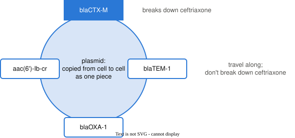

```{python}
#| echo: false
# About 15% of E. coli are resistant to ceftriaxone, in line with US surveillance: 15.3% of
# E. coli infections across VA hospitals in 2019 (Lancet Infect Dis 2024,
# doi:10.1016/S1473-3099(24)00416-X) and 12.9% of febrile UTIs at Kaiser Northern California
# (Ann Emerg Med 2021, doi:10.1016/j.annemergmed.2021.01.003).
#
# The panel's rule: any panel gene present -> call resistant. It misses resistance from a gene
# the panel doesn't test, and over-calls isolates carrying a panel gene that doesn't break down
# ceftriaxone.
import numpy as np

genes = ["blaCTX-M", "blaCMY-2", "blaSHV"]
share_resistant = 0.15

# P(gene present | class). Resistant isolates mostly carry CTX-M; a few carry none of the
# three. Susceptible isolates occasionally carry one.
gene_prob = {"resistant":   np.array([0.75, 0.12, 0.08]),
             "susceptible": np.array([0.02, 0.02, 0.03])}

def draw_isolate(rng):
    if rng.random() < share_resistant:
        growth = "resistant"
    else:
        growth = "susceptible"
    present = rng.random(3) < gene_prob[growth]
    return growth, present

def panel_call(present):
    if present.any():
        return "resistant"
    return "susceptible"

def draw_isolates(n, rng):
    rows = []
    for i in range(n):
        growth, present = draw_isolate(rng)
        rows.append({"isolate": f"EC-{i + 1:03d}", "present": present,
                     "call": panel_call(present), "growth": growth})
    return rows

def confusion(rows):
    c = {"TP": 0, "FP": 0, "FN": 0, "TN": 0}
    for r in rows:
        if r["call"] == "resistant" and r["growth"] == "resistant":
            c["TP"] += 1
        elif r["call"] == "resistant":
            c["FP"] += 1
        elif r["growth"] == "resistant":
            c["FN"] += 1
        else:
            c["TN"] += 1
    return c

def rates(c):
    n = c["TP"] + c["FP"] + c["FN"] + c["TN"]
    return {"n": n,
            "agree": c["TP"] + c["TN"],
            "accuracy":    (c["TP"] + c["TN"]) / n,
            "sensitivity": c["TP"] / (c["TP"] + c["FN"]),
            "specificity": c["TN"] / (c["TN"] + c["FP"]),
            "PPV":         c["TP"] / (c["TP"] + c["FP"])}

# The hand-countable table: 12 isolates. Seed 45 was chosen so that all four cells of the
# confusion table are filled: 2 caught, 1 missed (EC-011), 1 over-called (EC-012), 8 cleared.
small = draw_isolates(12, np.random.default_rng(45))
s = confusion(small)
sr = rates(s)
assert s == {"TP": 2, "FP": 1, "FN": 1, "TN": 8}
assert small[10]["call"] == "susceptible" and small[10]["growth"] == "resistant"
assert small[11]["call"] == "resistant" and small[11]["growth"] == "susceptible"

# A year of isolates: 500.
year = draw_isolates(500, np.random.default_rng(606))
y = confusion(year)
yr = rates(y)
y_res = y["TP"] + y["FN"]
y_sus = y["TN"] + y["FP"]
y_call_res = y["TP"] + y["FP"]

def f2(x):
    return f"{x:.2f}"

def pct(x):
    return f"{x:.0%}"

def big(n):
    return f"{n:,}"

import itertools
import matplotlib.pyplot as plt
plt.rcParams.update({"font.size": 14})

# Naive Bayes on the three-gene panel. The tables are presented as measured on last year's
# isolates; they are the simulation's own probabilities, so the scores are honest.
prior = share_resistant

def nb_posterior(present, table_r, table_s):
    like_r, like_s = prior, 1 - prior
    for i in range(len(present)):
        if present[i]:
            like_r = like_r * table_r[i]
            like_s = like_s * table_s[i]
        else:
            like_r = like_r * (1 - table_r[i])
            like_s = like_s * (1 - table_s[i])
    return like_r / (like_r + like_s), like_r, like_s

tab_r, tab_s = gene_prob["resistant"], gene_prob["susceptible"]
is_res = np.array([r["growth"] == "resistant" for r in year])
score3 = np.array([nb_posterior(r["present"], tab_r, tab_s)[0] for r in year])

# the worked isolate: blaCTX-M only
ex_present = np.array([True, False, False])
ex_post, ex_r, ex_s = nb_posterior(ex_present, tab_r, tab_s)

# every gene pattern seen in the year, with its score and what the growth test said
patterns = []
for pat in itertools.product([True, False], repeat=3):
    pat = np.array(pat)
    m = np.array([np.array_equal(r["present"], pat) for r in year])
    if m.sum() > 0:
        patterns.append({"marks": " ".join("+" if p else "–" for p in pat),
                         "score": nb_posterior(pat, tab_r, tab_s)[0],
                         "n": int(m.sum()), "grew": int(is_res[m].sum())})
patterns.sort(key=lambda p: -p["score"])

def at_threshold(score, t):
    call = score >= t
    c = {"TP": int((call & is_res).sum()), "FP": int((call & ~is_res).sum()),
         "FN": int((~call & is_res).sum()), "TN": int((~call & ~is_res).sum())}
    return c, rates(c)

thresholds = [0.05, 0.5, 0.95]
thr = {t: at_threshold(score3, t) for t in thresholds}

def roc_points(score):
    pts = [(0.0, 0.0)]
    for t in sorted(set(score), reverse=True):
        c, r = at_threshold(score, t)
        pts.append((1 - r["specificity"], r["sensitivity"]))
    pts.append((1.0, 1.0))
    return np.array(pts)

roc3 = roc_points(score3)

# The expanded panel: three genes that ride on the blaCTX-M plasmid (blaTEM-1, blaOXA-1,
# aac(6')-Ib-cr; commonly co-carried with blaCTX-M-15 on the plasmids of ST131 E. coli). In 85%
# of blaCTX-M carriers the plasmid brings all three; otherwise each turns up 3% of the time.
partner_genes = ["blaTEM-1", "blaOXA-1", "aac(6')-Ib-cr"]
together, background = 0.85, 0.03
rng = np.random.default_rng(607)
partners = []
for r in year:
    if r["present"][0] and rng.random() < together:
        partners.append(np.array([True, True, True]))
    else:
        partners.append(rng.random(3) < background)
partners = np.array(partners)

# Each new gene's own table entry is correct on its own (its share in each class); only the
# joint behaviour is missing, which is what naive Bayes leaves out.
def partner_share(cls):
    p_ctx = gene_prob[cls][0]
    return p_ctx * together + (1 - p_ctx * together) * background

tab6_r = np.concatenate([tab_r, [partner_share("resistant")] * 3])
tab6_s = np.concatenate([tab_s, [partner_share("susceptible")] * 3])
present6 = [np.concatenate([r["present"], partners[i]]) for i, r in enumerate(year)]
score6 = np.array([nb_posterior(p, tab6_r, tab6_s)[0] for p in present6])
roc6 = roc_points(score6)

all_four = np.array([p[0] and p[3] and p[4] and p[5] for p in present6])
none6 = np.array([not p.any() for p in present6])
four_score = score6[all_four].mean()
four_grew = is_res[all_four].mean()
none_score = score6[none6].mean()
none_grew = is_res[none6].mean()

# calibration: group isolates by score, keep groups of at least 10 isolates
def calibration(score, edges=(0, 0.1, 0.5, 0.9, 0.99, 1.0001)):
    out = []
    for lo, hi in zip(edges[:-1], edges[1:]):
        m = (score >= lo) & (score < hi)
        if m.sum() >= 10:
            out.append((score[m].mean(), is_res[m].mean(), int(m.sum())))
    return out

cal3, cal6 = calibration(score3), calibration(score6)
```

# From a call to a score

## Where we left off

- The rule *any gene present → resistant* gives one call per isolate
- It can't trade misses for over-calls: it has no setting to move
- What we want instead: a **score** for each isolate, and a **threshold** we choose

## A score for each isolate

- In unit 5 we computed the posterior probability of each class
- For an isolate, the posterior is the probability it is resistant, given which genes it carries:

$$P(\text{resistant} \mid \text{genes})$$

- A posterior near 1 means the genes point strongly to resistant; near 0, to susceptible
- We'll compute it with **naive Bayes**, the classifier from unit 5

## What naive Bayes needs

Measured on last year's isolates:

- the share of isolates that are resistant: `{python} f2(prior)`
- for each gene, how often it is present in each class:

| Gene | Present in resistant isolates | Present in susceptible isolates |
|---|:-:|:-:|
| *blaCTX-M* | `{python} f2(tab_r[0])` | `{python} f2(tab_s[0])` |
| *blaCMY-2* | `{python} f2(tab_r[1])` | `{python} f2(tab_s[1])` |
| *blaSHV* | `{python} f2(tab_r[2])` | `{python} f2(tab_s[2])` |

. . .

Each gene is far more common in resistant isolates, *blaCTX-M* most of all.

## Scoring one isolate

An isolate with *blaCTX-M* present, *blaCMY-2* and *blaSHV* absent.

Multiply the share of each class by one factor per gene: present → the table's value, absent → 1 minus it.

```{python}
#| echo: false
#| output: asis
print(rf"""$$
\begin{{aligned}}
\text{{resistant}}: &\quad {f2(prior)} \times {f2(tab_r[0])} \times {f2(1 - tab_r[1])} \times {f2(1 - tab_r[2])} = {ex_r:.4f} \\
\text{{susceptible}}: &\quad {f2(1 - prior)} \times {f2(tab_s[0])} \times {f2(1 - tab_s[1])} \times {f2(1 - tab_s[2])} = {ex_s:.4f}
\end{{aligned}}
$$""")
```

## Scoring one isolate (cont.)

Divide by the total, as in unit 5:

```{python}
#| echo: false
#| output: asis
print(rf"$$P(\text{{resistant}} \mid \text{{genes}}) = \frac{{{ex_r:.4f}}}{{{ex_r:.4f} + {ex_s:.4f}}} = {f2(ex_post)}$$")
```

. . .

- The isolate's score is `{python} f2(ex_post)`
- *Naive* means each gene's factor is multiplied in as if the genes were unrelated to each other
    - We'll come back to this assumption at the end of the session

## Every gene pattern gets a score

The year's `{python} yr["n"]` isolates, grouped by which genes they carry:

| *blaCTX-M* *blaCMY-2* *blaSHV* | Score | Isolates |
|:-:|:-:|:-:|
| `{python} patterns[0]["marks"]` | `{python} f2(patterns[0]["score"])` | `{python} patterns[0]["n"]` |
| `{python} patterns[1]["marks"]` | `{python} f2(patterns[1]["score"])` | `{python} patterns[1]["n"]` |
| `{python} patterns[2]["marks"]` | `{python} f2(patterns[2]["score"])` | `{python} patterns[2]["n"]` |
| `{python} patterns[3]["marks"]` | `{python} f2(patterns[3]["score"])` | `{python} patterns[3]["n"]` |
| `{python} patterns[4]["marks"]` | `{python} f2(patterns[4]["score"])` | `{python} patterns[4]["n"]` |
| `{python} patterns[5]["marks"]` | `{python} f2(patterns[5]["score"])` | `{python} patterns[5]["n"]` |
| `{python} patterns[6]["marks"]` | `{python} f2(patterns[6]["score"])` | `{python} patterns[6]["n"]` |

: {.striped}

- The rule from last time called every row except the last one *resistant*

# Thresholds

## From a score to a call

- Choose a **threshold**
- Score at or above the threshold → call the isolate **resistant**
- Score below it → call the isolate **susceptible**

. . .

- The *any gene* rule is one threshold: anything above the no-genes score of `{python} f2(patterns[-1]["score"])`
- But we can now put the threshold anywhere

## Moving the threshold

| Threshold | TP | FP | FN | TN | Sensitivity | Specificity |
|:-:|:-:|:-:|:-:|:-:|:-:|:-:|
| 0.05 | `{python} thr[0.05][0]["TP"]` | `{python} thr[0.05][0]["FP"]` | `{python} thr[0.05][0]["FN"]` | `{python} thr[0.05][0]["TN"]` | `{python} f2(thr[0.05][1]["sensitivity"])` | `{python} f2(thr[0.05][1]["specificity"])` |
| 0.5 | `{python} thr[0.5][0]["TP"]` | `{python} thr[0.5][0]["FP"]` | `{python} thr[0.5][0]["FN"]` | `{python} thr[0.5][0]["TN"]` | `{python} f2(thr[0.5][1]["sensitivity"])` | `{python} f2(thr[0.5][1]["specificity"])` |
| 0.95 | `{python} thr[0.95][0]["TP"]` | `{python} thr[0.95][0]["FP"]` | `{python} thr[0.95][0]["FN"]` | `{python} thr[0.95][0]["TN"]` | `{python} f2(thr[0.95][1]["sensitivity"])` | `{python} f2(thr[0.95][1]["specificity"])` |

. . .

- A **lower** threshold calls more isolates resistant → fewer misses, more over-calls
- A **higher** threshold calls fewer isolates resistant → fewer over-calls, more misses
- Moving the threshold is how we trade one mistake for the other

# The ROC curve

## Every threshold at once

- Each threshold gives one sensitivity and one specificity
- To see all the choices together, plot every threshold as a point:
    - up: **sensitivity**, the share of resistant isolates caught
    - across: **1 − specificity**, the share of susceptible isolates over-called
- The plot is called the **ROC curve** (receiver operating characteristic)

## The ROC curve

```{python}
#| echo: false
#| fig-align: center
fig, ax = plt.subplots(figsize=(8, 5.2))
ax.plot([0, 1], [0, 1], color="#c3c2b7", lw=1.2, ls="--")
ax.plot(roc3[:, 0], roc3[:, 1], "o-", color="#2a78d6", lw=2, ms=5)
for t, (dx, dy) in ((0.05, (0.12, -0.02)), (0.5, (0.12, -0.14)), (0.95, (0.12, 0.02))):
    r = thr[t][1]
    ax.annotate(f"threshold {t}", (1 - r["specificity"], r["sensitivity"]),
                xytext=(1 - r["specificity"] + dx, r["sensitivity"] + dy), fontsize=13,
                color="#52514e", arrowprops=dict(arrowstyle="-", color="#52514e", lw=0.8))
ax.set_xlabel("1 − specificity (susceptible isolates over-called)")
ax.set_ylabel("sensitivity (resistant caught)")
ax.set_xlim(-0.02, 1.02)
ax.set_ylim(-0.02, 1.02)
ax.spines[["top", "right"]].set_visible(False)
plt.show()
```

## Reading the ROC curve

- **Bottom left** (0, 0): call nothing resistant, the panel from last session that never says resistant
- **Top right** (1, 1): call everything resistant
- **Top left** (0, 1): catch every resistant isolate and over-call none, a perfect classifier
- **The dashed diagonal**: calls made at random, ignoring the genes

. . .

- The closer the curve comes to the top left, the better the score separates the classes
- Our curve rises steeply: a few over-calls buy most of the sensitivity

## Choosing a threshold

- The ROC curve shows every trade on offer; it doesn't choose one
- The choice comes from last session's question: which mistake is easier to live with?
    - Missed resistance worse → choose a point high on the curve, and accept more over-calls
    - Over-calls worse → choose a point further left, and accept more misses
- Same score, same isolates, different thresholds for different uses

# Can the score be trusted?

## What a score should mean

- The worked isolate scored `{python} f2(ex_post)`
- If the score means what it says, then among all isolates scored about `{python} f2(ex_post)`, about `{python} pct(ex_post)` should be resistant

. . .

- A classifier whose scores match how often the class actually occurs is **calibrated**
- Calibration matters whenever someone acts on the number itself, not just on the call
    - e.g. a doctor told "`{python} pct(ex_post)` chance of resistance"

## Checking calibration

Group the year's isolates by score, and compare each score with the share that grew on ceftriaxone:

| *blaCTX-M* *blaCMY-2* *blaSHV* | Score | Isolates | Share that grew |
|:-:|:-:|:-:|:-:|
| `{python} patterns[0]["marks"]` | `{python} f2(patterns[0]["score"])` | `{python} patterns[0]["n"]` | `{python} f2(patterns[0]["grew"] / patterns[0]["n"])` |
| `{python} patterns[1]["marks"]` | `{python} f2(patterns[1]["score"])` | `{python} patterns[1]["n"]` | `{python} f2(patterns[1]["grew"] / patterns[1]["n"])` |
| `{python} patterns[2]["marks"]` | `{python} f2(patterns[2]["score"])` | `{python} patterns[2]["n"]` | `{python} f2(patterns[2]["grew"] / patterns[2]["n"])` |
| `{python} patterns[3]["marks"]` | `{python} f2(patterns[3]["score"])` | `{python} patterns[3]["n"]` | `{python} f2(patterns[3]["grew"] / patterns[3]["n"])` |
| `{python} patterns[4]["marks"]` | `{python} f2(patterns[4]["score"])` | `{python} patterns[4]["n"]` | `{python} f2(patterns[4]["grew"] / patterns[4]["n"])` |
| `{python} patterns[5]["marks"]` | `{python} f2(patterns[5]["score"])` | `{python} patterns[5]["n"]` | `{python} f2(patterns[5]["grew"] / patterns[5]["n"])` |
| `{python} patterns[6]["marks"]` | `{python} f2(patterns[6]["score"])` | `{python} patterns[6]["n"]` | `{python} f2(patterns[6]["grew"] / patterns[6]["n"])` |

: {.striped}

Where there are enough isolates to tell, the scores match: the three-gene panel is calibrated.

## A bigger panel

The lab adds three more genes to the panel: *blaTEM-1*, *blaOXA-1* and *aac(6')-Ib-cr*.

- All three are found far more often in resistant isolates
- Each one's own table entry is correct:

| Gene | Present in resistant isolates | Present in susceptible isolates |
|---|:-:|:-:|
| *blaTEM-1*, *blaOXA-1*, *aac(6')-Ib-cr* (each) | `{python} f2(tab6_r[3])` | `{python} f2(tab6_s[3])` |

. . .

More genes, more evidence. Do the scores get better?

## Genes that travel together

{fig-align="center" width="85%"}

- The three new genes sit on the same **plasmid** as *blaCTX-M*: a small circle of DNA passed between bacteria as one piece
- They don't break down ceftriaxone themselves; they are found in resistant isolates because they travel with *blaCTX-M*

## The bigger panel's scores

`{python} int(all_four.sum())` isolates carry all four plasmid genes:

- naive Bayes scores them `{python} f"{four_score:.4f}"`
- `{python} pct(four_grew)` of them grew on ceftriaxone

. . .

`{python} int(none6.sum())` isolates carry none of the six genes:

- naive Bayes scores them `{python} f"{none_score:.3f}"`
- `{python} f"{none_grew:.1%}"` of them grew

. . .

The scores are too extreme in both directions: the bigger panel is **overconfident**.

## Calibration plot

```{python}
#| echo: false
#| fig-align: center
fig, ax = plt.subplots(figsize=(7.5, 5))
ax.plot([0, 1], [0, 1], color="#c3c2b7", lw=1.2, ls="--", label="calibrated")
for cal, colour, name in ((cal3, "#2a78d6", "three-gene panel"), (cal6, "#eb6834", "six-gene panel")):
    xs = [c[0] for c in cal]
    ys = [c[1] for c in cal]
    ax.plot(xs, ys, "o-", color=colour, lw=2, ms=6, label=name)
ax.set_xlabel("naive Bayes score")
ax.set_ylabel("share that grew on ceftriaxone")
ax.set_xlim(-0.02, 1.02)
ax.set_ylim(-0.02, 1.02)
ax.legend(frameon=False, loc="upper left")
ax.spines[["top", "right"]].set_visible(False)
plt.show()
```

Each point is a group of at least 10 isolates with similar scores.

## Why naive Bayes is overconfident

- Naive Bayes multiplies in one factor per gene, as if each gene were separate evidence
- The four plasmid genes are not separate: finding *blaCTX-M* nearly guarantees the other three
- So the same evidence, *this isolate carries the plasmid*, is counted four times

. . .

- In unit 5, counting one measurement twice moved the posterior without adding information
- Here it pushes scores toward 1 for plasmid carriers and toward 0 for everyone else

## Ranking and calibration are different

```{python}
#| echo: false
#| fig-align: center
fig, ax = plt.subplots(figsize=(8, 3.4))
ax.plot([0, 1], [0, 1], color="#c3c2b7", lw=1.2, ls="--")
ax.plot(roc3[:, 0], roc3[:, 1], "o-", color="#2a78d6", lw=2, ms=4, label="three-gene panel")
ax.plot(roc6[:, 0], roc6[:, 1], "o-", color="#eb6834", lw=2, ms=4, label="six-gene panel")
ax.set_xlabel("1 − specificity")
ax.set_ylabel("sensitivity")
ax.legend(frameon=False, loc="lower right")
ax.spines[["top", "right"]].set_visible(False)
plt.show()
```

- The two ROC curves nearly overlap: both panels **rank** isolates about equally well
- Only the calibration check shows that the bigger panel's numbers can't be taken at face value

## Unit 6 so far

- **Accuracy** is agreement with a reference, and the **confusion table** shows where it comes from
- **Sensitivity**, **specificity** and **PPV** each answer a narrower question
- False negatives and false positives have different consequences
- Accuracy and PPV depend on how common each class is
- A **score** and a **threshold** let us choose the trade; the **ROC curve** shows every choice
- A **calibrated** score means what it says; naive Bayes with linked genes doesn't

## Next time

The gene tables today came from "last year's isolates".

Next unit: where numbers like these should come from, and how to tell whether a classifier's reported performance is real.
